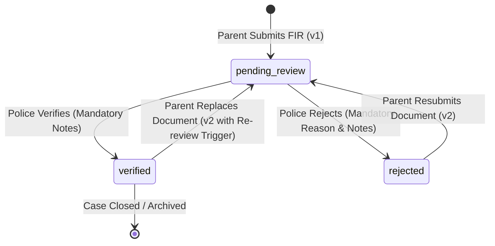

# GUARDIANLINK — PHASE 18 PRE-IMPLEMENTATION AUDIT
## COMPLETE FIR MODULE: DATA MODEL, DOCUMENT SECURITY & VERIFICATION PIPELINE

**Platform:** GuardianLink AI-Assisted Missing Child Safety Platform  
**Phase:** 18 — Complete FIR Module  
**Audit Date:** November 13, 2026  
**Auditor:** Senior Full-Stack, Backend Security & Database Integrity Engineering Team  
**Branch:** `goutam-devlopment`  
**Git Working Tree Status:** Clean  

---

## 1. EXISTING REPOSITORY ARCHITECTURE & RELEVANT FILE PATHS

The GuardianLink application consists of a multi-tier production architecture:
- **Frontend:** React 18, Vite 8, Tailwind CSS, React Router v6, Axios, Socket.IO client.
- **Backend:** Node.js 20 LTS, Express 4, MongoDB with Mongoose ODM, Redis session caching, JWT HttpOnly cookie authentication.
- **AI Microservice:** Python 3.12, FastAPI, InsightFace, ONNX Runtime, Qdrant vector database.
- **Storage Infrastructure:** Cloudinary media storage (currently public image uploads only), Multer memory storage.
- **Deployment:** Docker Compose multi-tier network (frontend-net, backend-net, ai-net, db-net) with reverse-proxy Nginx.

### Relevant Source Files Inspected:

#### Backend
- `server/models/MissingCase.js`: Case lifecycle state machine, `toSafeObject()`, `toPublicResponse()`, basic `firNumber` and `firDocumentUrl` fields.
- `server/models/User.js`: User identity, roles (`parent`, `police`, `ngo`, `citizen`, `admin`), account approval status (`approved`, `pending`, `rejected`), jurisdiction organization.
- `server/models/AuditLog.js`: Immutable audit trail schema and `AUDIT_ACTIONS` enum.
- `server/models/Notification.js`: Real-time notification persistence and delivery.
- `server/controllers/caseController.js`: Case creation, query filters, status updates, officer assignment.
- `server/routes/caseRoutes.js`: Case routing with `authenticate` and `authorize(...)` middleware.
- `server/middleware/upload.js`: Multer memory storage for single image uploads (`photo`).
- `server/config/cloudinary.js`: Cloudinary integration for public child photos.
- `server/utils/imageSecurityValidator.js`: Magic bytes validation for JPEG, PNG, and WebP.
- `server/utils/scriptGuard.js`: Production environment isolation guard.

#### Frontend
- `client/src/pages/parent/CaseDetails.jsx`: Parent case inspection (currently displays hardcoded "FIR Report Copy.pdf").
- `client/src/pages/parent/ReportMissingCase.jsx`: 4-step wizard for reporting missing child (contains optional `firNumber` text input).
- `client/src/pages/parent/MissingCasesList.jsx`: Parent case overview table.
- `client/src/pages/police/PoliceCaseDetails.jsx`: Police case inspection (contains placeholder "View" button for FIR document).
- `client/src/pages/police/PoliceCasesList.jsx`: Police operational case roster.
- `client/src/context/MissingCasesContext.jsx`: Parent case state management.
- `client/src/context/PoliceContext.jsx`: Police desk state management.
- `client/src/services/policeService.js` & `caseService.js`: Frontend Axios API adapters.

---

## 2. CURRENT FIR LIMITATIONS

1. **Primitive Schema Representation:** `MissingCase` schema contains only:
   ```javascript
   firNumber: { type: String, trim: true, default: "" },
   firDocumentUrl: { type: String, default: "" }
   ```
2. **Absence of Dedicated FIR Model:** No separate `FIR` collection exists. Critical legal metadata (police station, filing date, complainant name, relationship, legal penal codes, document versioning, checksums) cannot be tracked.
3. **No Document Versioning:** If a parent uploads an updated or corrected FIR document, previous versions and their verification histories are lost.
4. **No Police Verification State Machine:** FIR verification is non-existent. There is no `pending_review`, `verified`, or `rejected` status workflow, no mandatory review notes, and no append-only verification audit log.
5. **Insecure Document Storage Pattern:** The existing `firDocumentUrl` string assumes public Cloudinary image URLs. Public URLs allow unauthorized viewing of confidential legal police documents.
6. **Frontend Disconnection:** The "View" FIR buttons in `CaseDetails.jsx` and `PoliceCaseDetails.jsx` are dummy UI buttons triggering alert dialogs without real backend integration.
7. **No FIR Notifications:** Parents are not notified when police verify or reject an FIR, and police are not alerted when a new FIR is filed.

---

## 3. PROPOSED DATA MODEL: DEDICATED FIR SCHEMA (`server/models/FIR.js`)

A dedicated `FIR` Mongoose model will be established with an explicit relationship to `MissingCase`:

```javascript
// Relationship: Child -> MissingCase (1:Many over time) -> FIR (1:1 active, 1:Many historical versions)
```

### Key Schema Fields:
1. **Case Association:**
   - `missingCaseId`: `ObjectId`, ref: `MissingCase`, required, indexed.
   - `childId`: `ObjectId`, ref: `Child`, required, indexed.
   - `submittedBy`: `ObjectId`, ref: `User`, required, indexed.
2. **FIR Identification:**
   - `firNumber`: `String`, required, trim, uppercase. Indexed compound with `policeStation` (station-scoped uniqueness).
   - `policeStation`: `String`, required, trim.
   - `filingDate`: `Date`, required, cannot be in future.
   - `incidentDate`: `Date`, optional.
   - `district`: `String`, optional.
   - `state`: `String`, optional.
3. **Complainant Metadata (Scoped & Protected):**
   - `complainantName`: `String`, required, trim.
   - `relationship`: `String`, required, enum: `["Father", "Mother", "Guardian", "Relative", "Other"]`.
   - `contactPhone`: `String`, trim (visible only to police/admin).
4. **Document Versioning Array (`documents`):**
   - `version`: `Number`, default: 1.
   - `originalFilename`: `String`, required.
   - `storageKey`: `String`, required (private internal storage path or UUID).
   - `fileExtension`: `String`, enum: `[".pdf", ".jpg", ".jpeg", ".png"]`.
   - `mimeType`: `String`, enum: `["application/pdf", "image/jpeg", "image/png"]`.
   - `fileSizeBytes`: `Number`, required.
   - `sha256Checksum`: `String`, required (SHA-256 hex string).
   - `uploadedAt`: `Date`, default: `Date.now`.
   - `uploadedBy`: `ObjectId`, ref: `User`.
   - `isActive`: `Boolean`, default: true.
   - `replacementReason`: `String`, default: "".
5. **Verification State Machine:**
   - `status`: `String`, enum: `["pending_review", "verified", "rejected"]`, default: `"pending_review"`, indexed.
   - `currentOfficer`: `{ officerId, officerName, badgeNumber, verifiedAt }`.
6. **Append-Only Verification History (`verificationHistory`):**
   - `previousStatus`: `String`.
   - `newStatus`: `String`.
   - `officerId`: `ObjectId`, ref: `User`.
   - `officerName`: `String`.
   - `badgeNumber`: `String`.
   - `reviewedAt`: `Date`, default: `Date.now`.
   - `reviewNotes`: `String`, required (mandatory explanation).
   - `rejectionReason`: `String` (mandatory if rejected).
   - `documentVersion`: `Number`.
7. **Timestamps:** Mongoose `{ timestamps: true }`.

---

## 4. PROPOSED API ENDPOINTS

All endpoints will be mounted under `/api/firs` and strictly protected with `authenticate`:

| HTTP Method | Route | Authorization | Purpose |
| :--- | :--- | :--- | :--- |
| `POST` | `/api/firs/:caseId` | `authorize("parent")` | Submit initial FIR details and upload FIR document for own case. |
| `GET` | `/api/firs/case/:caseId` | `authorize("parent", "police", "ngo", "admin")` | Get FIR metadata and verification status for a case (role-scoped). |
| `GET` | `/api/firs/pending` | `authorize("police", "admin")` | List pending FIR records awaiting police verification. |
| `GET` | `/api/firs/:firId` | `authorize("parent", "police", "ngo", "admin")` | Get single FIR record with document history and review timeline. |
| `POST` | `/api/firs/:firId/documents/replace` | `authorize("parent")` | Upload corrected/resubmitted FIR document (increments version, triggers re-review). |
| `GET` | `/api/firs/:firId/documents/:docVersion/download` | `authorize("parent", "police", "admin")` | Securely download document bytes (PDF/JPG/PNG). |
| `GET` | `/api/firs/:firId/documents/:docVersion/preview` | `authorize("parent", "police", "admin")` | Securely stream document bytes for inline browser preview. |
| `PATCH` | `/api/firs/:firId/verify` | `authorize("police", "admin")` | Verify FIR document with mandatory officer review notes. |
| `PATCH` | `/api/firs/:firId/reject` | `authorize("police", "admin")` | Reject FIR document with mandatory rejection reason and review notes. |

---

## 5. ROLE-BASED ACCESS CONTROL (RBAC) & IDOR PROTECTION MATRIX

| Capability | Parent | Police (Approved) | NGO (Authorized) | Citizen | Admin |
| :--- | :---: | :---: | :---: | :---: | :---: |
| Submit FIR for own case | **YES** | NO | NO | NO | NO |
| Submit FIR for other parent's case | **DENIED (403)** | NO | NO | NO | NO |
| View FIR metadata (own case) | **YES** | **YES** | Scoped (Status only) | **DENIED (403)** | **YES** |
| Download/Preview FIR Document | **YES (Own)** | **YES (Jurisdiction)** | **DENIED (403)** | **DENIED (403)** | **YES** |
| Verify / Reject FIR | **DENIED (403)** | **YES (With Notes)** | **DENIED (403)** | **DENIED (403)** | **YES** |
| View Verification History | **YES (Own)** | **YES** | **DENIED (403)** | **DENIED (403)** | **YES** |
| Replace Rejected Document | **YES (Own)** | NO | NO | NO | NO |
| Access Public FIR Listing | NO (No public route) | NO | NO | NO | NO |

---

## 6. DOCUMENT SECURITY STRATEGY

1. **Private Storage Location:** Documents will be stored in `uploads/private_documents/firs/` on the server filesystem (outside Express static middleware), completely unexposed to the internet.
2. **Zero Public Cloudinary Delivery:** FIR documents will never be uploaded as public Cloudinary assets.
3. **No Direct Static URLs:** The client will never receive a permanent disk path or public URL. All file access must route through `/api/firs/:firId/documents/:docVersion/download` or `preview`.
4. **Deep Binary Header Inspection (Magic Bytes):**
   - Server validates raw file buffer bytes:
     - PDF: Must begin with `%PDF-` (`0x25, 0x50, 0x44, 0x46, 0x2D`).
     - JPEG: Must begin with `FF D8 FF`.
     - PNG: Must begin with `89 50 4E 47 0D 0A 1A 0A`.
   - Mismatches between file extension, declared MIME, and binary magic bytes are rejected with `400 INVALID_DOCUMENT_SIGNATURE`.
5. **PDF Active Content Neutralization:** PDF buffers are scanned for `/JavaScript`, `/JS`, `/Launch` active execution tags and rejected if malicious content is detected.
6. **Safe HTTP Response Headers:**
   - `Content-Type: application/pdf` or `image/jpeg` or `image/png`.
   - `Content-Disposition: inline; filename="..."` for preview or `attachment; filename="..."` for download.
   - `X-Content-Type-Options: nosniff`.
   - `Cache-Control: private, no-cache, no-store, must-revalidate`.
   - `Content-Security-Policy: default-src 'none'; sandbox`.
7. **Tamper Detection (SHA-256 Checksum):** Server computes `crypto.createHash('sha256').update(buffer).digest('hex')` upon upload. Document integrity is validated on access.

---

## 7. STATE MACHINE & CONCURRENCY CONTROLS



### Atomic Updates & Concurrency Guards:
- When a police officer verifies or rejects an FIR, the update uses Mongoose atomic findOneAndUpdate with state preconditions:
  ```javascript
  const fir = await FIR.findOneAndUpdate(
    { _id: firId, status: "pending_review" },
    { $set: { status: newStatus }, $push: { verificationHistory: reviewEntry } },
    { new: true }
  );
  ```
- Prevents race conditions where two officers review the same pending document simultaneously.

---

## 8. NOTIFICATION & AUDIT LOG INTEGRATION

1. **Audit Actions to Add to `server/models/AuditLog.js`:**
   - `FIR_CREATED`
   - `FIR_DOCUMENT_UPLOADED`
   - `FIR_DOCUMENT_REPLACED`
   - `FIR_DOCUMENT_ACCESSED`
   - `FIR_VERIFIED`
   - `FIR_REJECTED`
   - `FIR_DOCUMENT_DELETION_REQUESTED`
   - `FIR_DOCUMENT_ARCHIVED`
2. **Notification Types to Add to `server/models/Notification.js`:**
   - `fir_submitted`: Sent to investigating police station / assigned officer when parent files FIR.
   - `fir_verified`: Sent to reporting parent when police officer confirms FIR legitimacy.
   - `fir_rejected`: Sent to reporting parent with officer review notes explaining necessary corrections.
   - `fir_resubmitted`: Sent to police desk when parent uploads a corrected document.

---

## 9. POTENTIAL REGRESSION RISKS & MITIGATION

| Risk | Impact | Mitigation Strategy |
| :--- | :--- | :--- |
| Breaking `MissingCase.firNumber` backward compatibility | Existing UI components might expect `case.firNumber` | Sync `MissingCase.firNumber` automatically whenever a linked FIR record is created or verified. |
| Memory exhaustion from large document uploads | Server slowdown or OOM error | Limit Multer buffer size to 10MB; reject non-compliant files before streaming to disk. |
| Inability to run in Docker container due to directory permissions | Document upload fails with `EPERM` / `EACCES` | Ensure `uploads/private_documents/firs/` directory is created with verified write permissions. |
| Accidental disclosure of FIR documents to unauthorized roles | Data breach of legal juvenile documents | Strict authorization check on every download/preview endpoint; Citizens and unlinked NGOs receive 403. |
| Inconsistent verification status across Parent and Police portals | User confusion | Context providers auto-refresh upon Socket.IO `notification:new` events (`fir_verified`, `fir_rejected`, `fir_submitted`). |

---

## 10. IMPLEMENTATION SEQUENCE

1. **Step 1:** Complete and save this Pre-Implementation Audit Report (`PHASE_18_PRE_IMPLEMENTATION_AUDIT.md`).
2. **Step 2:** Create `server/utils/documentSecurityValidator.js` with magic bytes detection, SHA-256 hashing, and active-content sanitization.
3. **Step 3:** Create `server/models/FIR.js` with versioning, verification state machine, and append-only audit trail. Update `AuditLog.js` and `Notification.js` enums.
4. **Step 4:** Implement `server/services/firService.js` and `server/services/documentStorageService.js` for private storage and role-scoped operations.
5. **Step 5:** Create `server/controllers/firController.js` and `server/routes/firRoutes.js`; mount in `server/server.js`.
6. **Step 6:** Implement frontend FIR API service in `client/src/services/firService.js`.
7. **Step 7:** Build Parent FIR submission modal & status viewer in `client/src/pages/parent/CaseDetails.jsx` and `ReportMissingCase.jsx`.
8. **Step 8:** Build Police FIR verification & document inspection interface in `client/src/pages/police/PoliceCaseDetails.jsx` and `PoliceCasesList.jsx`.
9. **Step 9:** Enforce restricted NGO access (metadata status only, zero document access).
10. **Step 10:** Create `server/tests/phase18_fir.test.js` and execute test suites.
11. **Step 11:** Verify production client build (`npm run build`).
12. **Step 12:** Generate `PHASE_18_IMPLEMENTATION_REPORT.md` and present completion summary.

---
**PRE-IMPLEMENTATION AUDIT COMPLETE — PROCEEDING TO IMPLEMENTATION**

