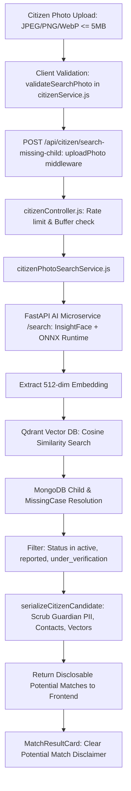

# GUARDIANLINK — PHASE 20 PRE-IMPLEMENTATION AUDIT
## COMPLETE CITIZEN PORTAL: REAL API INTEGRATION, SIGHTING MANAGEMENT, AI SEARCH & OFFICIAL RESPONDER WORKFLOW

**Date:** 2026-11-14  
**Target Branch:** `goutam-devlopment`  
**Phase:** 20  
**Status:** AUDIT COMPLETED — IMPLEMENTATION READY  

---

## 1. EXECUTIVE SUMMARY & REPOSITORY STATUS

- **Current Git Branch:** `goutam-devlopment` (up to date with origin).
- **Recent Commit History:**
  - `c3b1b8c Phase 19 ✅: Complete Location & Map Module` (Leaflet, OSM, GPS, role-based coordinate privacy)
  - `f504877 Phase 18 ✅: Complete FIR Module` (Private document security, police verification)
  - `a403aff Phase 17 ✅: Data Integrity & Critical Fixes` (PII protection, script guards, Permissions-Policy)
- **Primary Objective:** Transform the Citizen Portal from partially simulated workflows into a fully database-backed, real-API-driven citizen helper interface with genuine AI similarity candidate discovery, persistent sighting management, official responder notification dispatch, authenticated report details, registered assistance facilities, and zero guardian PII leakage.

---

## 2. FRONTEND ARCHITECTURE AUDIT

### 2.1 Files Inspected

1. `client/src/pages/citizen/CitizenDashboard.jsx`:
   - **Current State:** Displays quick action buttons and list of recent submitted reports from `useCitizen()`.
   - **Gaps:** Does not display aggregated summary stats (total submitted, under review, verified/resolved); relies on in-memory context without explicit loading/error states or empty-state guidance.
2. `client/src/context/CitizenContext.jsx`:
   - **Current State:** Contains `foundReports` state, calls `getMySightings()` and `getUserNotifications()`.
   - **Gaps:** `getReportById(reportId)` only looks up from memory array; if the page is refreshed or accessed directly by URL, it fails. Contains a simulated `requestGuardianContact()` in-memory callback.
3. `client/src/pages/citizen/CitizenReportDetails.jsx`:
   - **Current State:** Reads `const report = getReportById(reportId)` from context memory.
   - **Critical Vulnerability / Defect:** Direct navigation to `/citizen/reports/:reportId` or a browser refresh results in "Report Not Found" because it never fetches directly from `api.get(/api/sightings/:reportId)`.
4. `client/src/pages/citizen/FoundChildReportForm.jsx`:
   - **Current State:** Contains location picker (from Phase 19) and safety checkbox.
   - **Gaps:** Needs seamless submission to `POST /api/sightings` with error handling, preventing duplicate submission, and navigating directly to the created report details page.
5. `client/src/pages/citizen/FoundChildResult.jsx`:
   - **Current State:** Renders `MatchResultCard` and `GuardianContactModal`.
   - **Gaps:** Still mounts `GuardianContactModal` with simulated contact request; needs clean replacement with official law enforcement dispatch / sighting submission flow.
6. `client/src/components/citizen/GuardianContactModal.jsx`:
   - **Current State:** Sanitized in Phase 17 to show emergency numbers 1098/112, but still simulates a "Dispatch Official Police Alert" without real backend dispatch. Must be replaced with direct submission of the sighting to the official responder queue.
7. `client/src/components/citizen/NearbyHelpCard.jsx`:
   - **Current State:** Hardcoded static helpline array.
   - **Gaps:** Does not fetch genuine registered shelters from `Shelter` model or display registered facilities on an interactive Leaflet map. Needs integration with a dedicated public facilities endpoint.
8. `client/src/pages/citizen/CitizenReportsList.jsx`:
   - **Current State:** Lists `foundReports` from context. Needs proper pagination/filtering, real status badges, and loading/empty states.
9. `client/src/services/citizenService.js`:
   - **Current State:** Already has `searchMissingChildPhoto`, `submitSightingReport`, `getMySightings`, `getSightingDetails`, `getUserNotifications`.
   - **Enhancements Needed:** Add `getNearbyFacilities()` API call; ensure error codes and responses map cleanly.

---

## 3. BACKEND ARCHITECTURE AUDIT

### 3.1 Files Inspected

1. `server/routes/sightingRoutes.js` & `server/controllers/sightingController.js`:
   - `POST /api/sightings` -> `submitSighting`: submits report, calls `notifyAuthorizedRespondersForSighting`, returns `toSafeObject`.
   - `GET /api/sightings/mine` -> `getMySightings`: fetches reports where `reportedBy: req.user._id`.
   - `GET /api/sightings/:id` -> `getSightingById`: enforces ownership / responder authorization; returns safe object.
   - `PATCH /api/sightings/:id/review` -> `reviewSighting`: police review, creates `sighting_reviewed` notification for citizen.
2. `server/services/sightingService.js`:
   - `submitSighting`: enforces mandatory safety confirmation (`safetyConfirmed === true`), coordinates validation via Phase 19 `validateLocationCoordinates`, case eligibility check (`ELIGIBLE_CASE_STATUSES = ["active", "reported", "under_verification"]`).
   - `getSightingById`: checks if user is reporter, police, admin, or case guardian.
     - *Bug/Gap identified:* If `sightingId` is a canonical `sightingNumber` (e.g. `SR-123456`), `mongoose.Types.ObjectId.isValid` fails and rejects with 400. Needs support for both `_id` and `sightingNumber`.
3. `server/routes/citizenRoutes.js` & `server/controllers/citizenController.js`:
   - `POST /api/citizen/search-missing-child`: rate limited, handles single image upload, validates buffer, calls AI search.
   - *Enhancement Needed:* Add `GET /api/citizen/nearby-facilities` to return genuine registered shelters from MongoDB `Shelter.find({ status: "active" })`.
4. `server/models/Sighting.js`:
   - Contains `caseId`, `childId`, `reportedBy`, `observedAt`, `location`, `appearance`, `safetyState`, `status`, `reviewNotes`.
   - Status enum: `["submitted", "under_review", "verified", "dismissed"]`.
   - `toSafeObject`: scrubs exact coordinates, accuracy, source, address, and pinCode for non-reporters and unauthorized citizens.
5. `server/services/notificationService.js`:
   - `notifyAuthorizedRespondersForSighting`: notifies assigned police officer (if assigned to case), station officers, and verified guardian.
   - *Enhancement Needed:* Ensure receipt notification is also created for the reporting citizen (`sighting_reported`).

---

## 4. REAL AI PHOTO SEARCH PIPELINE TRACE

The existing AI similarity pipeline is production-grade and must be preserved:

**Critical Integrity Rules:**
- Zero frontend simulation or mock candidates.
- AI output represents unverified potential leads requiring human verification.
- Zero raw embeddings, Qdrant IDs, or guardian contact info exposed.

---

## 5. LOCATION INTEGRATION AUDIT (PHASE 19 REUSE)

- Reuses `LocationPicker.jsx` in `FoundChildReportForm.jsx`:
  - User-initiated GPS button (`"Use My Current GPS"`).
  - Accuracy badge (<25m, 25-100m, >100m).
  - Draggable marker and click-to-pin.
  - Explicit confirmation button before submission.
- Reuses `LocationDisplay.jsx` in `CitizenReportDetails.jsx` and `FoundChildLocationSharing.jsx`:
  - Displays sighting location pin with teal DivIcon.
  - Safe fallback when coordinates are absent or restricted.
- Reuses `LocationDisplay.jsx` in `NearbyHelpCard.jsx` to render registered shelter facilities on a map with purple DivIcons.

---

## 6. FAKE GUARDIAN CONTACT SIMULATION REMOVAL

- **Problem:** In previous prototype phases, `GuardianContactModal.jsx` and `workflowSession.requestGuardianContact()` simulated contacting the guardian.
- **Child Welfare & Legal Mandate:** Under the Juvenile Justice Act and missing child safety protocols, citizens must NEVER execute private contact or direct handovers.
- **Remediation:**
  - Remove fake in-memory contact requests.
  - Direct citizens to submit an official sighting report (`FoundChildReportForm.jsx`).
  - Provide direct one-touch priority dialing for official emergency authorities: **1098** (Childline) and **112** (Police).
  - Verify zero exposure of `guardianPhone`, `parentPhone`, `guardianEmail`, or residential address across all citizen serializers.

---

## 7. NEARBY FACILITIES IMPLEMENTATION (REGISTERED SHELTERS)

- **Problem:** `NearbyHelpCard.jsx` previously lacked actual database-backed facilities.
- **Remediation:**
  - Implement `GET /api/citizen/nearby-facilities` in backend.
  - Query active, registered shelters from MongoDB `Shelter.find({ status: "active" })`.
  - Return safe public facility details (name, address, city, state, coordinates, official contact phone, available spaces).
  - Display facility cards and an interactive `LocationDisplay` Leaflet map showing purple shelter pins.
  - If no registered shelters exist, show proper empty state: `"No registered assistance facilities are currently available in this area."`

---

## 8. PROPOSED IMPLEMENTATION SEQUENCE

1. **Step 2:** Update `server/routes/citizenRoutes.js` and `server/controllers/citizenController.js` to implement `GET /api/citizen/nearby-facilities`.
2. **Step 3:** Support canonical `sightingNumber` lookup in `server/services/sightingService.js` (`getSightingById`).
3. **Step 4:** Ensure reporting citizen receives receipt notification in `server/services/notificationService.js`.
4. **Step 5:** Enhance `client/src/services/citizenService.js` with `getNearbyFacilities()` and report direct fetch.
5. **Step 6:** Upgrade `client/src/context/CitizenContext.jsx` with real dashboard statistics, direct report fetch, and removal of mock contact simulation.
6. **Step 7:** Upgrade `client/src/pages/citizen/CitizenDashboard.jsx` with real database counts, loading skeleton, and genuine empty state.
7. **Step 8:** Upgrade `client/src/pages/citizen/CitizenReportDetails.jsx` to directly fetch from backend API with robust refresh handling, loading, and error states.
8. **Step 9:** Upgrade `client/src/pages/citizen/FoundChildReportForm.jsx` with real submission, idempotency, and Phase 19 location picker.
9. **Step 10:** Upgrade `client/src/pages/citizen/FoundChildResult.jsx` and remove `GuardianContactModal` simulation.
10. **Step 11:** Upgrade `client/src/components/citizen/NearbyHelpCard.jsx` with real registered facilities and Leaflet map.
11. **Step 12:** Author automated test suite `server/tests/phase20_citizen.test.js` covering dashboard stats, direct report fetch, IDOR protection, notification dispatch, facility queries, and PII protection.
12. **Step 13:** Execute test suite, run regression tests, verify Vite client production build.
13. **Step 14:** Generate final implementation report `PHASE_20_IMPLEMENTATION_REPORT.md`.

---
*Pre-Implementation Audit Complete. Proceeding to implementation.*

