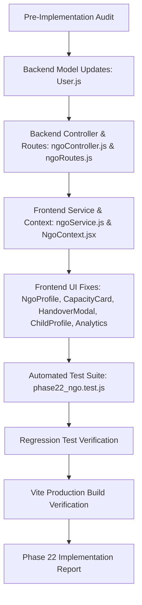

# GUARDIANLINK — PHASE 22: PRE-IMPLEMENTATION AUDIT
## NGO PORTAL COMPLETION: REAL API INTEGRATION, SHELTER MANAGEMENT, CHILD INTAKE, CARE RECORDS, HANDOVER AUTHORIZATION & OPTIONAL AI BIOMETRIC PRE-CHECK

**Document Version:** 1.0.0  
**Target Branch:** `goutam-devlopment`  
**Execution Phase:** Phase 22  
**Audit Date:** November 15, 2026  
**Auditor:** Senior Full-Stack Security & System Architecture Engineer  

---

## 1. EXECUTIVE SUMMARY & OBJECTIVE

The primary objective of Phase 22 is to complete the GuardianLink NGO Portal by integrating all frontend components with genuine backend routes, controllers, services, and MongoDB collections. The NGO portal manages child intake, shelter capacity accounting, daily care notes, medical status monitoring, authorized handover workflows, and optional AI-assisted biometric candidate pre-check.

An in-depth inspection of the existing codebase reveals that Phase 9 established an operational foundation for NGO endpoints (`server/services/ngoService.js`, `server/controllers/ngoController.js`, and `server/routes/ngoRoutes.js`). However, several key architectural gaps, missing profile endpoints, frontend mock data leaks, and authorization risks exist in the current implementation:

1. **Missing Backend Profile Endpoints**: `server/routes/ngoRoutes.js` lacks `GET /api/ngo/profile` and `PATCH /api/ngo/profile`. In the frontend, `NgoProfile.jsx` relies only on the initial session cookie without dedicated endpoints to view verified NGO registration numbers, issuing authorities, or update contact details. Furthermore, `User.js` lacks standard NGO licensing schema fields (`registrationNumber`, `registrationAuthority`, `registrationDate`, `darpanId`, `verifiedAt`).
2. **Missing AI Biometric Pre-Check Route**: `server/routes/ngoRoutes.js` lacks `POST /api/ngo/biometric-precheck` to allow authorized NGO staff to upload a photo of an escorted child and query the existing facial recognition pipeline (`citizenPhotoSearchService.js` / `aiService.js`) with appropriate "investigation lead only" disclaimers and guardian PII redaction.
3. **Frontend Handover Authorization Boundary Flaw**: In `client/src/context/NgoContext.jsx`, `confirmHandover` contained an unauthorized attempt (`await ngoService.approveHandover(handoverId)`) within the client-side flow. NGOs cannot approve handovers; only authorized police or administrators can approve handovers. The frontend must respect the police approval gate before handover completion.
4. **Mock Data Leaks & Runtime Bugs**:
   - `client/src/components/ngo/CapacityCard.jsx`: Hardcoded `"Helping Hands Kiosk - Sector 12"` and displays `NaN%` when `totalCapacity` is 0.
   - `client/src/components/ngo/HandoverConfirmationModal.jsx`: Hardcoded fictitious names (`"John Mehta"`, `"Insp. R. S. Rathore"`, `"Helping Hands Shelter Kiosk - Sector 12"`).
   - `client/src/pages/ngo/NgoDashboard.jsx`: Hardcoded fallbacks `"Helping Hands Organization"`, `"Shelter Kiosk Sector 12"`, and `"Helping Hands Team"`.
   - `client/src/pages/ngo/NgoAnalytics.jsx`: Static hardcoded values (`"25 minutes"`, `"1.8 days"`, `"88.5%"`).
   - `client/src/pages/ngo/NgoProfile.jsx`: Hardcoded green `Verified NGO` badge and static provider text even when the user account is in `"pending"` status.
   - `client/src/pages/ngo/NgoChildProfile.jsx`: Missing `useEffect` import from React and missing `ngoService` import, causing fatal `ReferenceError` crashes on direct navigation.

---

## 2. EXISTING CODEBASE INVENTORY

### 2.1 Backend Architecture

| Component | Path | Status | Operational Capabilities / Missing Elements |
| :--- | :--- | :--- | :--- |
| **User Model** | `server/models/User.js` | Needs Extension | Contains `role: "ngo"`, `organization`, `status`, `isVerified`. Needs optional NGO registration fields (`registrationNumber`, `registrationAuthority`, `registrationDate`, `darpanId`, `verifiedAt`). |
| **Shelter Model** | `server/models/Shelter.js` | Complete & Robust | Tracks `name`, `ngoId`, `address` (with lat/lng), `capacity`, `activePlacements`, `status`, `facilities`, `staffCount`. Virtuals for `availableSpaces` and `occupancyRate`. |
| **CareRecord Model** | `server/models/CareRecord.js` | Complete & Robust | Tracks `caseId`, `childId`, `ngoId`, `shelterId`, `intakeNumber`, `status` (`pending_intake`, `in_care`, `awaiting_handover`, `handed_over`, `closed`), `initialCondition`, `careNotes`, `medicalStatus`, `policeCoordination`, `provisions`. |
| **Handover Model** | `server/models/Handover.js` | Complete & Robust | Tracks `careRecordId`, `caseId`, `childId`, `ngoId`, `handoverType`, `status` (`pending`, `approved`, `completed`, `rejected`), `requestedBy`, `approvedBy`, `completedBy`, `guardianDetails`, `receivingOfficer`. |
| **NGO Routes** | `server/routes/ngoRoutes.js` | Partially Complete | Contains `/dashboard-stats`, `/referrals`, `/care-records`, `/shelters`, `/handovers`. **Missing:** `/profile` (`GET`, `PATCH`) and `/biometric-precheck` (`POST`). |
| **NGO Controller** | `server/controllers/ngoController.js` | Partially Complete | Implements shelter and care handlers with audit logging. Needs `getNgoProfile`, `updateNgoProfile`, and `biometricPrecheck`. Profile handlers must allow pending NGOs to view/edit without `ensureApproved` blocking. |
| **NGO Service** | `server/services/ngoService.js` | Comprehensive | Handles dashboard stats, referrals, intake with atomic `$expr` capacity check, shelter management, care notes, medical status, handover state machine. |
| **Biometric Search** | `server/services/citizenPhotoSearchService.js` | Complete & Reusable | Privacy-safe face search using existing FastAPI/InsightFace pipeline with strict PII allowlist and "potential lead" disclaimer. |

### 2.2 Frontend Architecture

| Component | Path | Status | Findings & Required Remediation |
| :--- | :--- | :--- | :--- |
| **NGO Context** | `client/src/context/NgoContext.jsx` | Needs Refinement | Provides `currentNgo`, `shelterInfo`, `shelters`, `childrenInCare`, `referrals`, `transfers`. Remove illegal `approveHandover` attempt in `confirmHandover`. Add profile sync. |
| **NGO Service Client**| `client/src/services/ngoService.js` | Needs Extension | Normalizes CareRecords, shelters, handovers. Add `getNgoProfile`, `updateNgoProfile`, and `biometricPrecheck`. |
| **NgoProfile** | `client/src/pages/ngo/NgoProfile.jsx` | Mock Leaks | Static verification badge regardless of account status; no edit form; no pending verification notice. Needs genuine profile connect with edit modal. |
| **CapacityCard** | `client/src/components/ngo/CapacityCard.jsx` | Bug & Mock | Hardcoded shelter title `"Helping Hands Kiosk - Sector 12"`. Produces `NaN%` when capacity is 0. |
| **NgoDashboard** | `client/src/pages/ngo/NgoDashboard.jsx` | Mock Leaks | Hardcoded `"Helping Hands..."` fallbacks in header. |
| **NgoAnalytics** | `client/src/pages/ngo/NgoAnalytics.jsx` | Mock Leaks | Static pipeline numbers (`"25 minutes"`, `"1.8 days"`, `"88.5%"`). Compute dynamically from real stats. |
| **HandoverConfirmationModal** | `client/src/components/ngo/HandoverConfirmationModal.jsx` | Mock Leaks | Hardcoded `"John Mehta"`, `"Insp. R. S. Rathore"`, `"Helping Hands..."`. Populate from actual record. |
| **NgoChildProfile** | `client/src/pages/ngo/NgoChildProfile.jsx` | Critical Bug | Missing `useEffect` and `ngoService` imports. |
| **NgoShelterManagement** | `client/src/pages/ngo/NgoShelterManagement.jsx` | Functional | Connected to Phase 19 `LocationDisplay` and real shelter API. |
| **NgoIntakeWizard** | `client/src/pages/ngo/NgoIntakeWizard.jsx` | Functional | 5-step intake wizard connected to real referrals and shelter selection. |
| **NgoTransfers** | `client/src/pages/ngo/NgoTransfers.jsx` | Functional | Connected to real handover requests and shelter/medical transfer selection. |

---

## 3. AUDIT OF ACCEPTANCE CRITERIA (AC-22.1 — AC-22.30)

### 3.1 Dynamic NGO Profile & Licensing (AC-22.1 — AC-22.5)
- **Requirements**:
  - `GET /api/ngo/profile`: Return authenticated NGO organization details, verified license number, issuing authority, registration date, Darpan ID, address, contact info, and verification status (`pending`, `approved`, `rejected`).
  - `PATCH /api/ngo/profile`: Allow updating organization address, city, state, pinCode, contactPhone, and Darpan ID. Protect verification fields (`status`, `isVerified`, `verifiedAt`) from client tampering (anti-IDOR & privilege escalation prevention).
  - Unapproved/Pending NGOs: Must be permitted to view and edit basic profile details so they can rectify submission issues, while operational care records remain gated.
  - Frontend Display: Show real verification status. Display an amber "Pending Verification" banner if `status === "pending"`, and green "Verified NGO" badge only if `status === "approved"`.
- **Current State**: Endpoints missing on backend. Schema fields missing in `User.js`. Frontend displays hardcoded green badge.
- **Action Plan**:
  - Add NGO fields to `User.js`.
  - Add `getNgoProfile` and `updateNgoProfile` to `ngoController.js` and `ngoRoutes.js`.
  - Update `client/src/services/ngoService.js` and `NgoProfile.jsx`.

### 3.2 Shelter & Facility Management (AC-22.6 — AC-22.9)
- **Requirements**:
  - `GET /api/ngo/shelters`: Return all shelters owned by the authenticated NGO.
  - `POST /api/ngo/shelters`: Create new shelter facility with validated GPS coordinates (`validateLocationCoordinates`), positive capacity, and auto-assigned `ngoId = req.user._id`.
  - `PATCH /api/ngo/shelters/:shelterId`: Update shelter details; enforce boundary check preventing reduction of capacity below currently occupied beds (`activePlacements`).
  - Cross-Organization Scoping: Strict isolation ensuring NGO A cannot view or modify shelters owned by NGO B.
- **Current State**: Backend service and controller already implement these checks. Frontend `NgoShelterManagement.jsx` already integrates with `LocationDisplay` for interactive mapping.

### 3.3 Live Shelter Occupancy & Concurrency (AC-22.10 — AC-22.12)
- **Requirements**:
  - Enforce `availableBeds = capacity - occupiedBeds`.
  - Enforce atomic `$inc` updates with `$expr: { $lt: ["$activePlacements", "$capacity"] }` during intake/placement.
  - Zero negative beds, zero duplicate counts.
  - Concurrency safety under simultaneous placement requests.
- **Current State**: Backend `ngoService.js` lines 247-264 and 647-650 enforce atomic increment and capacity bounds. Frontend `CapacityCard.jsx` needs fix for `NaN%` when capacity is 0.

### 3.4 Child Intake Wizard & Referrals (AC-22.13 — AC-22.15)
- **Requirements**:
  - `GET /api/ngo/referrals`: List missing cases eligible for safe intake (`active`, `found`, `reunited`) that do not already have an active `CareRecord`.
  - `POST /api/ngo/care-records`: Safe child intake creating `CareRecord`.
  - Server-enforced child and case validation (never trust client child identity without verifying against case).
  - Derive staff identity from active session (`req.user._id`), never accept client-spoofed staff author.
  - Enforce shelter capacity validation before admitting child.
- **Current State**: Backend fully enforces these rules in `ngoService.js`. Frontend `NgoIntakeWizard.jsx` supports prefilling from referrals.

### 3.5 Dynamic Care Records & Medical Status (AC-22.16 — AC-22.18)
- **Requirements**:
  - `GET /api/ngo/care-records`: Retrieve all care records scoped to `req.user._id`.
  - `POST /api/ngo/care-records/:careRecordId/notes`: Append timestamped care note with category and author.
  - `PATCH /api/ngo/care-records/:careRecordId/medical-status`: Update medical status (`stable`, `monitoring`, `attention_required`, `emergency`).
  - `PATCH /api/ngo/care-records/:careRecordId/status`: Enforce finite state machine transitions (`pending_intake` -> `in_care` -> `awaiting_handover` -> `handed_over` / `closed`).
- **Current State**: Fully implemented in backend `ngoService.js`. Frontend `CareUpdateFormModal.jsx` and `NgoChildProfile.jsx` connect to these endpoints.

### 3.6 Optional AI Biometric Pre-Check (AC-22.19 — AC-22.22)
- **Requirements**:
  - Endpoint: `POST /api/ngo/biometric-precheck` accepting multipart file upload (`image`/`photo`).
  - Safe reuse of existing FastAPI / InsightFace / ONNX / Qdrant search pipeline via `citizenPhotoSearchService.searchMissingChildPhoto`.
  - Lead only: Candidates must be explicitly marked with `matchStatus: "potential"` and carry the official disclaimer: `"Potential biometric lead. Requires independent law enforcement and guardian verification."`
  - Zero Guardian PII: Redact residential coordinates, guardian phone numbers, and raw embeddings.
  - Audit logging of AI match queries.
- **Current State**: Pipeline exists in `citizenPhotoSearchService.js`, but route is not exposed under `/api/ngo/biometric-precheck`.
- **Action Plan**: Wire endpoint in `ngoRoutes.js` and `ngoController.js`, add client service method in `client/src/services/ngoService.js`.

### 3.7 Handover Authorization Workflow (AC-22.23 — AC-22.26)
- **Requirements**:
  - `POST /api/ngo/care-records/:careRecordId/handovers`: Request handover for family reunification or custody transfer.
  - Authorization Boundary: NGOs CANNOT approve handovers (`PATCH /api/ngo/handovers/:handoverId/approve` restricted to police and admin).
  - Police Approval Enforcement: `completeHandover` strictly requires `handover.status === "approved"`.
  - Automatic Shelter Bed Release: Upon completed handover, atomically decrement `Shelter.activePlacements`.
- **Current State**: Backend correctly restricts `approveHandover` and `rejectHandover` to police/admin. Frontend `NgoContext.jsx` line 343 had an erroneous client-side auto-approval attempt that must be removed. `HandoverConfirmationModal.jsx` must be cleaned of mock names.

### 3.8 UI Data Integrity & Mock Elimination (AC-22.27 — AC-22.30)
- **Requirements**:
  - Eliminate all hardcoded mock names (`"Helping Hands Kiosk - Sector 12"`, `"John Mehta"`, `"Insp. R. S. Rathore"`).
  - Fix `CapacityCard.jsx` `NaN%` bug.
  - Fix `NgoChildProfile.jsx` missing imports.
  - Compute `NgoAnalytics.jsx` performance metrics dynamically.
  - Ensure zero mock data or simulated responses across the entire NGO portal.

---

## 4. ACTION PLAN & IMPLEMENTATION ROADMAP

1. **Step 1: Backend Model Extension (`server/models/User.js`)**
   - Add optional fields: `registrationNumber`, `registrationAuthority`, `registrationDate`, `darpanId`, `address`, `verifiedAt`.
2. **Step 2: Backend Controller & Route Additions (`server/controllers/ngoController.js`, `server/routes/ngoRoutes.js`)**
   - Add `getNgoProfile`: Returns NGO profile data for authenticated user (accessible by pending & approved NGOs).
   - Add `updateNgoProfile`: Validates and updates organization profile, protecting verification fields.
   - Add `biometricPrecheck`: Uses `uploadPhoto` middleware and `citizenPhotoSearchService.searchMissingChildPhoto`.
   - Register routes `/api/ngo/profile` and `/api/ngo/biometric-precheck`.
3. **Step 3: Frontend API & Context Updates (`client/src/services/ngoService.js`, `client/src/context/NgoContext.jsx`)**
   - Export `getNgoProfile`, `updateNgoProfile`, `biometricPrecheck`.
   - Update `NgoContext.jsx`: Load real profile from `/api/ngo/profile`, remove forbidden `approveHandover` call, guard capacity calculations.
4. **Step 4: Frontend UI Remediation**
   - Fix `CapacityCard.jsx`: Guard `totalCapacity === 0`, remove hardcoded subtitle.
   - Fix `HandoverConfirmationModal.jsx`: Remove hardcoded `"John Mehta"`, `"Insp. R. S. Rathore"`, use child data.
   - Fix `NgoChildProfile.jsx`: Add missing `useEffect` and `ngoService` imports.
   - Fix `NgoDashboard.jsx`: Replace hardcoded `"Helping Hands..."` fallbacks.
   - Fix `NgoAnalytics.jsx`: Replace static pipeline numbers with dynamic values.
   - Fix `NgoProfile.jsx`: Display real verification badge and add edit modal.
5. **Step 5: Automated Verification Suite (`server/tests/phase22_ngo.test.js`)**
   - Profile retrieval and update validation with IDOR and role protection.
   - Shelter creation, capacity boundaries, and organization isolation.
   - Atomic concurrency and occupancy invariants.
   - Child intake and duplicate intake prevention.
   - Care notes and medical status lifecycle transitions.
   - Handover workflow: creation, rejection of unauthorized NGO approval, police approval requirement, and bed release.
   - Biometric precheck: lead status, disclaimer, and PII protection.
6. **Step 6: Regression Testing & Client Build**
   - Run regression suites: Phases 13, 15, 17, 18, 19, 20, 21.
   - Execute `npm --prefix client run build`.
7. **Step 7: Implementation Report**
   - Generate `PHASE_22_IMPLEMENTATION_REPORT.md`.

