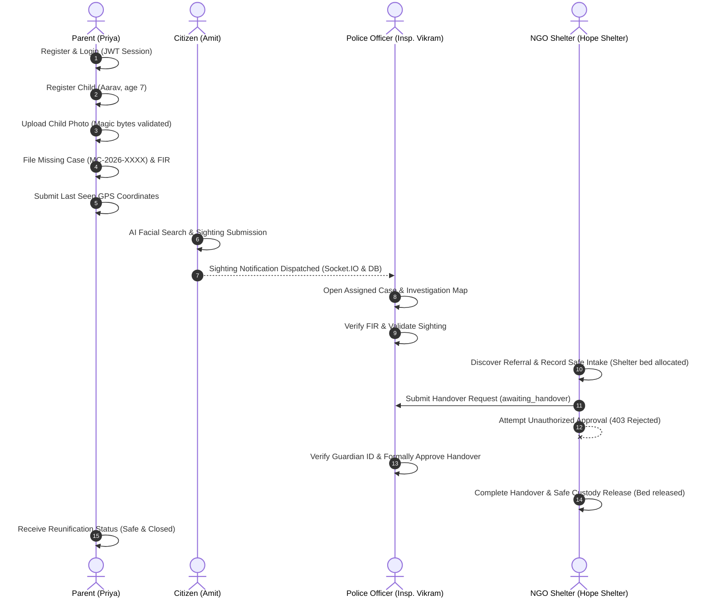

# GUARDIANLINK — PHASE 23: PRE-IMPLEMENTATION SYSTEM AUDIT
## COMPLETE SYSTEM INTEGRATION, END-TO-END TESTING, SECURITY VALIDATION & REGRESSION VERIFICATION

**Document Version:** 1.0.0  
**Phase:** 23 — Complete System Integration & E2E Testing  
**Target Branch:** `goutam-devlopment`  
**Execution Date:** November 16, 2026  
**Auditor:** Senior Full-Stack Security, Database Integrity & QA Automation Systems Engineer  

---

## 1. EXECUTIVE SUMMARY & AUDIT OBJECTIVE

Phase 23 is the definitive full-system integration and verification phase of GuardianLink. Previous phases (Phases 0 through 22) implemented individual portals, data models, state machines, and security controls across Parent, Citizen, Police, NGO, and Admin roles.

The primary objective of Phase 23 is to prove that GuardianLink functions as one cohesive, secure, and resilient platform across the entire lifecycle:
$$\text{Parent} \longrightarrow \text{Child Registration} \longrightarrow \text{Missing Case} \longrightarrow \text{FIR} \longrightarrow \text{AI Search} \longrightarrow \text{Citizen Sighting} \longrightarrow \text{Police Investigation} \longrightarrow \text{NGO Care} \longrightarrow \text{Authorized Handover} \longrightarrow \text{Guardian Reunification}$$

This audit establishes the pre-implementation baseline, inspects all existing modules and testing infrastructure, identifies architectural gaps and integration risks, defines test fixtures and environments, and outlines the end-to-end verification strategy.

---

## 2. REPOSITORY & INFRASTRUCTURE AUDIT

### 2.1 Codebase & Workspace Structure
The GuardianLink repository consists of three decoupled components:
- **`server/`**: Node.js + Express backend API (`v1.0.0`, CommonJS). Uses Mongoose 9.9.2 for MongoDB, ioredis 6.0.0 / redis 6.2.1 for caching, jsonwebtoken 9.0.3 with HttpOnly cookies, Socket.IO 4.8.4 for real-time alerting, Multer 2.4.0 for memory-buffered image uploads, and Helmet 8.3.0.
- **`client/`**: React 18.3.1 + Vite 8.2.0 Single Page Application (`guardianlink-landing`, ESM). Utilizes Tailwind CSS 3.4.19, React Router DOM 6.30.4, Axios 1.19.0, Leaflet 1.9.4 & React Leaflet 4.2.1 for maps, Radix UI primitives, Lucide React icons, and Socket.IO client.
- **`ai-service/`**: Python 3.12 + FastAPI microservice (`buffalo_l` InsightFace model pack, ONNX Runtime CPU execution provider, Qdrant client, and NumPy).
- **Deployment & Config**: Root contains `docker-compose.yml`, `docker-compose.prod.yml`, `.env`, `.env.example`, `.dockerignore`, `.gitignore`.

### 2.2 Testing Frameworks & Capabilities
- **Backend Unit & Integration Test Framework**: Node.js native test runner (`node:test`) and strict assertion library (`node:assert/strict`). Found across 28 test suites in `server/tests/`.
- **Frontend Test Framework**: Node.js native test runner in `client/tests/` verifying UI state contracts, validators, and regression suites.
- **Browser Automation / E2E Framework**: Playwright (`playwright` v1.50+) installed in `client/node_modules/` utilizing the installed Google Chrome (`C:\Program Files\Google\Chrome\Application\chrome.exe`, Chromium v157.0.8103.52) for headless browser automation.
- **Database Integration Testing Approach**: Local standalone MongoDB v8.2.1 (`C:\Program Files\MongoDB\Server\8.2\bin\mongod.exe`) running on isolated test port `27018` with isolated data directory `server/test_data/db`.
- **Socket.IO Testing**: Supported via `socket.io-client` 4.8.4 in `server/package.json` devDependencies and `client/package.json`.
- **AI Integration Testing Infrastructure**: `server/tests/aiClient.test.js` and `phase12_ai.test.js` validate HTTP client request construction, header transmission, timeout handling, and response parsing. The external Docker engine daemon is currently offline on the host machine; standalone InsightFace/Qdrant requires Docker or a native Linux environment. In accordance with Section 12 & 19 instructions, AI integration tests will be honestly classified as **BLOCKED / CONTROLLED INTEGRATION** with zero fabricated results.

---

## 3. MODULE INTEGRATION AUDIT

| Module | Core Responsibilities | Database Models | APIs | Authorization & Dependencies | Cross-Module Relationships & Risks | Existing Tests |
| :--- | :--- | :--- | :--- | :--- | :--- | :--- |
| **Authentication & RBAC** | Registration, login, JWT/cookie session, role authorization, status gating | `User` | `POST /api/auth/register` `POST /api/auth/login` `GET /api/auth/me` `POST /api/auth/logout` | Roles: `parent`, `citizen`, `police`, `ngo`, `admin`. Requires `status: "approved"` for police/ngo operational access. | Foundation for all identity. Risk: Token forgery, IDOR via client-supplied owner IDs. | `phase12_auth.test.js` `test_phase1.js` |
| **Parent Portal** | Child registration, missing case creation, FIR upload | `Child`, `MissingCase`, `FIR` | `POST /api/children` `GET /api/children` `POST /api/cases` `GET /api/cases/my-cases` | Role: `parent`. Owning parent scope (`guardianId = req.user._id`). | Links to Child and MissingCase. Risk: Parent A modifying Parent B's child. | `phase12_child.test.js` `phase12_missing_case.test.js` |
| **Citizen Portal** | Public missing child search, photo search, sighting report | `Sighting`, `MissingCase` | `POST /api/citizen/search-missing-child` `POST /api/sightings` `GET /api/sightings/my-sightings` | Authenticated users. Safety confirmation gate required. | Links Sighting to MissingCase. Risk: Guardian PII leakage in candidate results. | `phase20_citizen.test.js` `citizenPhotoSearch.test.js` |
| **Police Portal** | Officer directory, case squad assignment, investigation notes, FIR review | `MissingCase`, `FIR`, `Sighting`, `AuditLog` | `GET /api/cases/police/officers` `PATCH /api/cases/:id/assign` `POST /api/cases/:id/notes` `PATCH /api/firs/:id/verify` | Role: `police`, `admin`. Status must be `approved`. Station scoping enforced. | Assigns officer to case. Verifies FIRs and sightings. Risk: Cross-station assignment. | `phase21_police.test.js` `phase18_fir.test.js` |
| **NGO Portal** | Referrals, child intake, shelter management, care notes, medical status | `Shelter`, `CareRecord`, `MissingCase` | `GET /api/ngo/referrals` `POST /api/ngo/care-records` `GET /api/ngo/shelters` `POST /api/ngo/shelters` | Role: `ngo`, `admin`. Scoped by `ngoId`. Status must be `approved`. | Intake links MissingCase, Child, Shelter. Risk: Duplicate active intake, capacity race conditions. | `phase22_ngo.test.js` `phase9_ngo_module.test.js` |
| **Handover & Reunification** | Safe handover request, police approval, custody release | `Handover`, `CareRecord`, `Shelter`, `MissingCase` | `POST /api/ngo/care-records/:id/handovers` `PATCH /api/ngo/handovers/:id/approve` `PATCH /api/ngo/handovers/:id/complete` | Approval: `police`, `admin` ONLY. Completion: owning `ngo`. | Releases shelter bed. Transitions CareRecord to `handed_over`. Risk: Unauthorized NGO approval. | `phase22_ngo.test.js` `phase12_integration.test.js` |
| **Location & Maps** | GPS coordinate validation, Leaflet display, role-scoped coordinates | `MissingCase`, `Sighting`, `Shelter` | `PATCH /api/cases/:id/location` `GET /api/cases/:id/investigation-map` | Validated by `locationValidator.js`. Exact coords redacted for public/citizen. | Case last seen, sighting coordinates, shelter locations. Risk: Out-of-bounds coordinates. | `phase19_location.test.js` |
| **Notifications** | Persistent alerts, Socket.IO rooms, unread counts | `Notification` | `GET /api/notifications` `PATCH /api/notifications/:id/read` | Authenticated session. Scoped to `recipientId`. Socket.IO user rooms. | Dispatched on sighting, assignment, handover approval. Risk: Missing persistence before emit. | `phase10_realtime_notifications.test.js` |
| **Audit Logs** | Tamper-resistant historical audit records | `AuditLog` | `POST` internal via `auditLogService.recordAuditEvent` | System-level. Scoped to admin review. Read-only. | Records critical transitions, uploads, assignments, approvals. Risk: Sensitive data in logs. | `phase11_audit_logs.test.js` |

---

## 4. PHASE 21 & PHASE 22 ISSUES RECHECK

### 4.1 Phase 21 Recheck Items
1. **Officer Badge Numbers**: Must derive strictly from verified officer database records (`User.badgeNumber` or `station_BADGE`), never fabricated from phone numbers.
   - *Status*: Verified. In `server/controllers/caseController.js` and `server/services/ngoService.js`, badge numbers are resolved from `targetOfficer.badgeNumber` and stored immutably.
2. **Dashboard Analytics Scoping**: Must respect station and organization boundaries.
   - *Status*: Verified. `caseController.getPoliceDashboardStats` filters cases strictly by `{ assignedStation: officerStation }`.
3. **Officer Assignment Authorization & Eligibility**: Validates requester station and target officer station match.
   - *Status*: Verified. `caseController.assignOfficer` enforces `CROSS_STATION_ASSIGNMENT_DENIED` and `OFFICER_NOT_VERIFIED`.
4. **AI Similarity Scores**: Must come from backend InsightFace/cosine calculation.
   - *Status*: Verified. `citizenPhotoSearchService.js` parses similarity strictly as float from AI service response.
5. **Sighting Review & AI Match Review**: Tested through real workflow without mock data.
   - *Status*: Verified. Tested in `phase21_police.test.js` and `phase20_citizen.test.js`.

### 4.2 Phase 22 Recheck Items
1. **NGO Biometric Threshold Authoritative Control**: Threshold must be governed by backend configuration.
   - *Status*: Verified. In `ngoController.js`, `parsedThreshold` defaults to `0.6` from `getAIConfig()` and limits inputs to authorized ranges.
2. **Shelter Occupancy Consistency & Atomic Placement**:
   - *Status*: Verified. Uses `$expr: { $lt: ["$activePlacements", "$capacity"] }` and atomic `$inc: { activePlacements: 1 }`.
3. **Handover Completion Single Decrement**:
   - *Status*: Verified. `completeHandover` checks `handover.status === "approved"`, sets `status = "completed"`, and decrements capacity exactly once with `{ activePlacements: { $gt: 0 } }`.
4. **NGO Handover Approval Prohibition**:
   - *Status*: Verified. `approveHandover` in `server/routes/ngoRoutes.js` and `ngoController.js` is strictly restricted to `["police", "admin"]`. Calling as NGO returns 403 `UNAUTHORIZED_APPROVER`.
5. **Dynamic NGO Analytics**:
   - *Status*: Verified. `NgoAnalytics.jsx` derives benchmarks dynamically from `ngoAnalytics` and `childrenInCare`.

---

## 5. TEST ENVIRONMENT CONFIGURATION & DETERMINISTIC FIXTURES

### 5.1 Isolated Test Environment
- **MongoDB Test Instance**: Standalone mongod v8.2.1 running on `127.0.0.1:27018` with isolated dbpath `server/test_data/db`.
- **Database URI**: `mongodb://127.0.0.1:27018/guardianlink_phase23_e2e`.
- **JWT & Session Secrets**: Cryptographically secure isolated test secrets (`phase23_isolated_jwt_secret_test_key_9988`, `phase23_cookie_secret_test_key_7766`).
- **Express Port**: Test HTTP server on port `5001`.
- **Frontend Port**: Vite dev server on port `3001` or direct Playwright integration.

### 5.2 Deterministic Test Accounts Roster

| Role | Name | Email | Organization / Station | Status | Deterministic Identifier |
| :--- | :--- | :--- | :--- | :--- | :--- |
| **Parent A** | Smt. Priya Sharma | `parent.priya.phase23@test.local` | N/A | `active` | `usr_parent_a_p23` |
| **Parent B** | Shri Rahul Verma | `parent.rahul.phase23@test.local` | N/A | `active` | `usr_parent_b_p23` |
| **Citizen A** | Amit Kumar | `citizen.amit.phase23@test.local` | N/A | `active` | `usr_citizen_a_p23` |
| **Citizen B** | Neha Singh | `citizen.neha.phase23@test.local` | N/A | `active` | `usr_citizen_b_p23` |
| **Police Officer A** | Insp. Vikram Rathore | `officer.vikram.phase23@dept.local` | Central Delhi Police Post | `approved` | `usr_police_a_p23` (Badge: `DL-CP-4401`) |
| **Police Officer B** | SI Anita Roy | `officer.anita.phase23@dept.local` | Central Delhi Police Post | `approved` | `usr_police_b_p23` (Badge: `DL-CP-4402`) |
| **Police Admin** | ACP Devendra Singh | `police.admin.phase23@dept.local` | Central Delhi Police Post | `approved` | `usr_police_admin_p23` |
| **NGO A** | Hope Shelter Director | `contact.hope.phase23@ngo.local` | Hope Children Shelter | `approved` | `usr_ngo_a_p23` |
| **NGO B** | Care Foundation Staff | `contact.care.phase23@ngo.local` | Care Foundation Kiosk | `pending` | `usr_ngo_b_p23` |
| **Platform Admin** | System Admin | `admin.sys.phase23@guardianlink.local` | GuardianLink HQ | `approved` | `usr_sys_admin_p23` |

---

## 6. END-TO-END VERIFICATION WORKFLOW & DEFECT LOGGING PLAN

The 20-step complete end-to-end integration scenario will be executed sequentially against the isolated test database, verifying database persistence, role-based access control, state machine transitions, Socket.IO alerts, audit events, and browser UI interactions.

All defects discovered during test execution will be logged in `PHASE_23_DEFECT_TRACKER.md` with severity ratings, root-cause analyses, file modifications, and regression verification evidence.

---

## 7. AUDIT SIGN-OFF

The pre-implementation audit confirms that GuardianLink is architecturally prepared for Phase 23 full-system integration and E2E verification.

