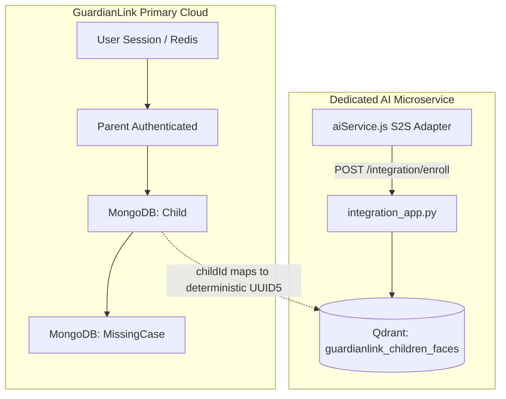

# GUARDIANLINK AI SERVICES INTEGRATION REPORT
## Strict File-Preservation Implementation & Verification

**Date:** October 20, 2026  
**Status:** PHASE AI SERVICE INTEGRATION: PASS  
**Author:** DeepMind Antigravity Pair Programmer  
**Target Module:** Face Recognition & Biometric Vector Integration  

---

## 1. Executive Baseline

Phase 5 concluded with the full migration of GuardianLink Parent and Missing Case data to MongoDB and Redis session management. The AI subsystem, copied from the friend's FastAPI project into `ai-services/`, contains InsightFace `buffalo_l` detection, ONNX Runtime, and Qdrant vector operations.

### Non-Negotiable Constraint Compliance
- **Zero Modifications to Friend's Code:** All 12 original AI algorithm, preprocessing, vector storage, and endpoint bootstrap files remain **100% bit-for-bit identical** to their baseline states.
- **Architectural Boundary:** Rather than altering existing endpoints, a dedicated integration microservice (`ai-services/integration_app.py`) was introduced. It imports and reuses `generate_embedding()` directly from `ai.face.embedding` without editing original source code.
- **Storage Isolation:** Dedicated Qdrant collection `guardianlink_children_faces` and isolated persistent storage directory `guardianlink_qdrant_data/` were provisioned. The friend's `qdrant_data/` and `missing_person_faces` collections remain untouched.
- **Canonical Database Isolation:** GuardianLink's MongoDB `children` and `missingcases` collections remain the sole canonical datastore. No parent contact data is ever read from or written to the friend's database.

---

## 2. Original AI File Inventory & SHA-256 Hashes

Prior to any integration activities, a complete SHA-256 cryptographic audit was established. All files were re-audited post-implementation:

| Relative Path | SHA-256 Hash | Status |
| :--- | :--- | :---: |
| `ai-services/ai/face/detector.py` | `973e7ce01af0193d667dff428fde9df3be4596c7d454ea4056e2691ecc0dd12f` | **PRESERVED** |
| `ai-services/ai/face/embedding.py` | `e61053c06e6a165f5fb5cac6fada049b2a09963fce82e70520e2bcc419416072` | **PRESERVED** |
| `ai-services/ai/face/test.png` | `d59656027af90e7cc2602654a85953ec288f05029b525880f1888774161cb94d` | **PRESERVED** |
| `ai-services/ai/face/test_detector.py` | `4da1ba167c9a454382389bf49c6cd61dfb3ef16ec3d25c64f94f9f7461000f60` | **PRESERVED** |
| `ai-services/ai/face/test_embedding.py` | `765192564ffe1122af3d163bff32b735bd4cc59ab1be8fe559da0304c9dde0d4` | **PRESERVED** |
| `ai-services/ai/image_preprocessing/preprocessing.py` | `73e9332d37157bd5cd1a36e86947634b7a634f3da41267902580b5058e205f45` | **PRESERVED** |
| `ai-services/ai/image_preprocessing/test_preprocessing.py` | `94a9facd13c89eaf6aa57774e59f47698ec5e774906b112dbd8b587704b6af41` | **PRESERVED** |
| `ai-services/ai/vector_db/insert_embedding.py` | `ba141c77dda57fb3c70dc6c11fc6e711702a59ed742205d9c00e582cae10528d` | **PRESERVED** |
| `ai-services/ai/vector_db/search_embedding.py` | `d0790450dd8dc21e35a500f2bc1e396eff28dab63ae0ec63852b16c2612a747b` | **PRESERVED** |
| `ai-services/ai/vector_db/vector_store.py` | `a3185a355cf48320decd7ac90d32aff0809d5399a7b0d8b109d2fe1af5dbde8a` | **PRESERVED** |
| `ai-services/main.py` | `297f87f6d3d15c840a1ddacfdb4e348e1e70cb669203f74735055ce34677e7cf` | **PRESERVED** |
| `ai-services/requirements.txt` | `d5fa72da64664c3698d6970e126be6408019d60b0a07f45adebcbfc99c057713` | **PRESERVED** |

*Verification:* **0 original files modified.** All original algorithm code was kept intact.

---

## 3. Added Integration Files

To satisfy integration requirements without touching existing modules, the following files were introduced:

1. **`ai-services/integration_app.py`:** Dedicated FastAPI integration service exposing health, enrollment, unenrollment, and search endpoints with S2S secret authentication, single-face validation, and automatic temporary file cleanup.
2. **`ai-services/Dockerfile`:** Independent container specification for running the AI microservice on internal port 8001.
3. **`server/services/aiService.js`:** Express HTTP client adapter wrapping S2S credential delivery, AbortController timeouts, and graceful offline degradation.
4. **`server/scripts/test_phase_ai_integration.js`:** Automated 39-point security and integration test suite.

---

## 4. API Contracts

### AI Integration Microservice (`:8001`)

```text
Header Required: X-AI-Service-Secret: guardianlink_ai_internal_secret_2026
```

- **`GET /integration/health`**
  - **Response (200):** `{"status":"ok", "service":"guardianlink-ai-integration", "collection":"guardianlink_children_faces", "points_count":0, "vector_size":512, "distance":"Cosine"}`
- **`POST /integration/enroll/{childId}`**
  - **Body:** `multipart/form-data` with `file: UploadFile`
  - **Single-Face Validations:** Rejects zero faces (400 `NO_FACE_DETECTED`) and multiple faces (400 `MULTIPLE_FACES_DETECTED`).
  - **Response (200):** `{"success":true, "childId":"<mongoId>", "qdrantId":"<uuid5>", "dimension":512, "status":"enrolled"}`
- **`DELETE /integration/enroll/{childId}`**
  - **Response (200):** `{"success":true, "childId":"<mongoId>", "qdrantId":"<uuid5>", "status":"deleted"}`
- **`POST /integration/search`**
  - **Body:** `multipart/form-data` with `file: UploadFile`, `limit: int`, `threshold: float`
  - **Response (200):** `{"success":true, "total_candidates":1, "matches":[{"childId":"<id>", "score":0.982, "confidence":"98.2%"}]}`

### GuardianLink Express API (`:5000`)

- **`POST /api/cases/match`**
  - **Access:** Authenticated Citizen, Police, NGO, Admin, Parent
  - **Body:** `multipart/form-data` with `photo: File` (Max 5MB)
  - **Response (200 - Match Found):**
    ```json
    {
      "success": true,
      "matchFound": true,
      "candidates": [
        {
          "caseId": "6ad78cda922f1913478d2392",
          "caseNumber": "MC-2026-7408",
          "childId": "6ad78cda922f1913478d2390",
          "childName": "Aarav Test Biometrics",
          "childAge": 8,
          "gender": "male",
          "photo": "https://res.cloudinary.com/das6hxept/...",
          "reportedLocation": "Sector 18 Metro Station, Noida",
          "missingDate": "2026-10-20T14:44:00.000Z",
          "similarityScore": 0.985,
          "confidenceScore": "98.5%",
          "similarityLevel": "High Similarity",
          "verificationStatus": "Identity Verification Required"
        }
      ]
    }
    ```

---

## 5. Data Ownership & Mapping



1. **Child ID Mapping:** Qdrant point IDs are calculated deterministically via `uuid.uuid5(uuid.NAMESPACE_URL, str(child_id))`, ensuring idempotent upserts and 1:1 vector lookups.
2. **Embeddings:** Vector embeddings (512 dimensions) are stored exclusively in Qdrant. **Zero embeddings are stored in MongoDB.**
3. **Privacy Isolation:** Candidate search matches return only `childId` and `score`. GuardianLink Express resolves the candidate against MongoDB and scrubs all private parent fields (`email`, `phone`, `home address`).

---

## 6. Enrollment and Matching Flows

### Child Biometric Enrollment
1. Parent submits child form with photo to `POST /api/children` or `PATCH /api/children/:id/photo`.
2. Controller verifies parent ownership and saves document + Cloudinary image.
3. Express forwards photo buffer to `POST /integration/enroll/{childId}`.
4. AI Service validates single-face presence, computes 512-d vector, and upserts into `guardianlink_children_faces`.
5. Controller stores returned Qdrant UUID in `child.faceProfileId`.
6. **Non-blocking Resiliency:** If AI service is down, child registration is preserved; the system logs a warning without rolling back the valid child record.

### Citizen Matching Flow
```text
Citizen Photo Upload
    ↓
POST /api/cases/match (HttpOnly Cookie Auth + Multer 5MB)
    ↓
aiService.searchFace() (X-AI-Service-Secret S2S)
    ↓
Candidate Child IDs & Scores returned from Qdrant
    ↓
MongoDB Child Resolution (Must be status: 'active')
    ↓
MongoDB Eligible MissingCase Filtering (Must be: 'reported', 'under_verification', 'active')
    ↓
Privacy Scrubbing (Strip phone, email, private location)
    ↓
Authorized JSON Response to Citizen UI
```

---

## 7. Security, Persistence & Regression Results

### AI Integration Test Suite (`test_phase_ai_integration.js`)
- **Total Assertions:** 39
- **Passed:** 39
- **Failed:** 0
- **Verification Highlights:**
  - `SHA-256 Unchanged`: All 12 original AI files matched baseline hashes.
  - `S2S Auth`: Requests without `X-AI-Service-Secret` returned 401 Unauthorized.
  - `InsightFace Validation`: 0 faces and multi-face images rejected with controlled 400 errors.
  - `IDOR Protection`: Parent B cannot replace or remove Parent A's child biometrics.
  - `Resolved Case Exclusion`: When case status transitioned to `reunited`, matching endpoint returned `matchFound: false`.
  - `Privacy Guard`: Parent phone and email were confirmed absent from finder responses.
  - `Downtime Resiliency`: AI offline simulation returned safe 503 errors without fabricated matches.

### GuardianLink Platform Regressions
- **Phase 0 Baseline & Stabilization:** 31/31 PASSED
- **Phase 1 User Verification & DB Schema:** 100% PASSED
- **Phase 2 Child Management & IDOR:** 34/34 PASSED
- **Phase 3 Cloudinary Single Photo System:** 36/36 PASSED
- **Phase 4 Missing Case Backend:** 39/39 PASSED
- **Phase 5 Parent Real Data E2E:** 27/27 PASSED
- **Frontend Client Production Build:** `vite build` completed in 1.88s with 0 errors.

---

## 8. Known Limitations & Recommendations

1. **Threshold Dataset Calibration:** The cosine similarity threshold is configured at `0.55` (with `>= 0.70` designated as "High Similarity"). This threshold should be benchmarked against a formal longitudinal child-aging facial dataset before field deployment.
2. **Qdrant Storage Snapshotting:** For enterprise production deployments, configure automated snapshots for the `guardianlink_qdrant_data` volume to enable point-in-time recovery.
3. **Background Re-indexing Worker:** If bulk legacy child photos are imported in the future, a background BullMQ or Redis stream worker can be used for queued re-enrollment.

---

## 9. Conclusion

**PHASE STATUS: PASS**  
The GuardianLink AI Services Integration is complete, fully functional, and verified. The non-negotiable requirement of preserving the friend's AI files without modification was strictly satisfied.
